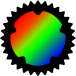
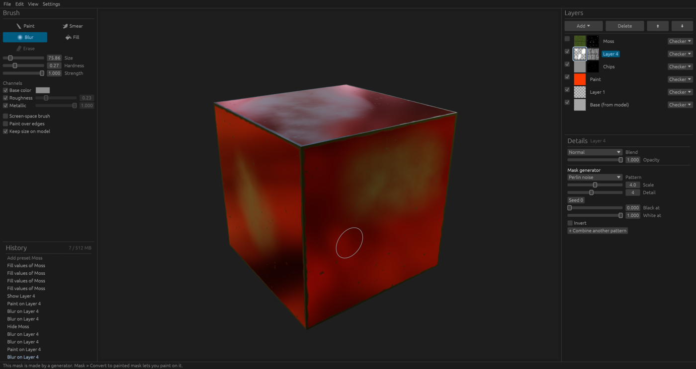
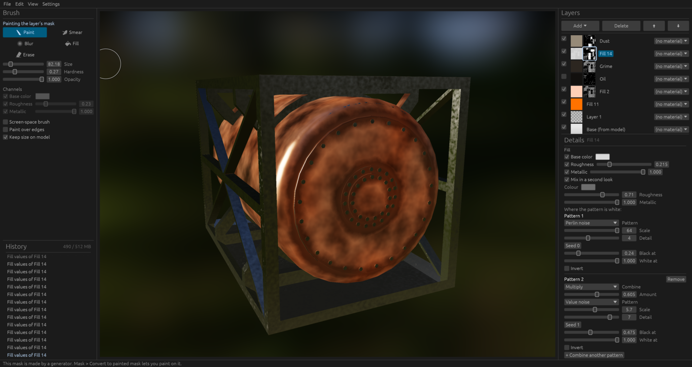
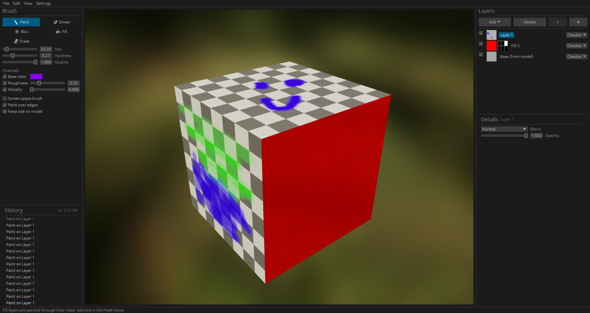

<p align="center">
  
</p>

<h1 align="center">RustPaint</h1>

<p align="center">
  A lightweight 3D texturing app written in Rust: paint PBR textures straight onto your models.
</p>

RustPaint loads a 3D model, lets you paint its base color, roughness,
metallic and height in layers, and exports the finished textures (with a
normal map) or the whole model. It is
meant to be a straightforward, crash-resistant alternative for texturing
objects, with procedural tools (generators, edge wear, cavity, presets) for
quick results such as rust and dirt.

<p align="center">
  
  
  
</p>

> **Early stage.** It works, but the project file format may still change, and
> normal maps that come with an imported model aren't kept yet. Don't use it
> as the only copy of important work.

## Features

- **Painting in 3D** with Paint, Smear, Blur and Fill tools. The brush is
  either a sphere on the surface (same size on the model, wraps around edges)
  or a flat screen-space projection. Soft or hard, with erase.
- **PBR channels:** base color, roughness, metallic and height, painted
  together or one at a time. Imported glTF materials are kept.
- **Bumps from height:** paint or fill height (0.5 is level) to raise and sink
  the surface. The viewport shades the bumps, and they export as a normal map.
  The bump depth is set on the Base layer.
- **Texture size** per material, from 256 to 8192, also on the Base layer:
  lower for low-poly work or to save memory, higher for detail. Painted layers
  are resampled; patterns and fills are made again at the new size.
- **Layers** with opacity, blend modes (Normal, Multiply, Screen, Overlay,
  Darken, Lighten, Add) and per-material-slot targets, composited on the GPU.
  The model's own textures stay untouched as the base layer.
- **Masks** you paint on, as in Photoshop or Substance Painter. Every tool
  works on a mask.
- **Fill layers and generators:** a fill layer puts one set of values on the
  whole model and shows through its mask. A mask can come from a generator
  instead: noise, cells, gradients, **checker**, **stripes**, **bricks**,
  **tiles**, **edge wear** (chipped paint along convex edges) and **cavity**
  (dirt in creases). Patterns are worked out from the model's shape, not its
  UVs, so they have no seams and don't stretch. Bricks and tiles with a height
  fill give mortar grooves with bevelled edges. Several
  patterns can be combined, and a fill can mix between two colours.
- **Presets:** one-click stacks such as Rust, Chipped paint, Grime, Moss,
  Brick wall and Tiles, and your own, saved as small files you can share.
- **Undo history** you can jump around in, and **autosave with crash
  recovery**. Work you choose not to save is kept under *File > Autosaves*.
- **Export** the textures as PNGs (with a tangent-space normal map, OpenGL
  convention), or the model with its painted textures as a `.glb` for
  Blender, Godot, Unity, Unreal or a web viewer.
- **HDR lighting** in the viewport, with built-in environments or your own
  `.hdr` / `.exr`.

## Getting started

Install the stable [Rust toolchain](https://rustup.rs), then:

```sh
git clone https://github.com/PaperShreds/rustpaint.git
cd rustpaint
cargo run --release
```

Then use **File > Open model...** to open a `.glb` or `.gltf` file (or drag one
into the window), pick a layer, and paint. Save your work as a `.rustpaint`
project with **File > Save project**.

On Linux, run `assets/linux/install.sh` once after building so the desktop
shows RustPaint's name and icon in the dock and top bar (Wayland desktops find
them through a launcher file, not from the program). `--uninstall` removes it.

### Controls

| Input | Action |
| --- | --- |
| Left drag | Paint |
| Right drag, or Alt + left drag | Orbit |
| Middle drag, or Shift + right drag | Pan |
| Scroll | Zoom |
| Ctrl+Z, Ctrl+Shift+Z (or Ctrl+Y) | Undo, redo |
| Ctrl+S, Ctrl+Shift+S, Ctrl+N | Save, save as, new project |

The panels: brush settings and the undo history on the left, layers (with the
selected layer's details below) on the right. The **Add** button above the
layer list adds paint layers, fill layers, presets and masks.

### Good to know

- Painting a non-metal over metal with a soft brush leaves a pale ring where
  the two mix. That is how the values blend, and engines show the same with the
  exported textures. Use a hard brush where metal meets non-metal.
- Edge wear and cavity need sharp folds in the mesh (10 degrees or more);
  smooth surfaces get none.
- The program remembers its settings, presets, recovery copies and autosaves in
  a `rustpaint` folder in your user data directory (`~/.local/share/rustpaint/`
  on Linux).

## Development

```sh
cargo build
cargo test
```

Dependencies are built with optimizations even in debug builds, because
painting runs on the CPU and would be too slow otherwise. If `target/` grows
large over time, `cargo clean` clears it.

## License

RustPaint is free software under the [GNU GPL v3](LICENSE).

## Credits

- The logo (`assets/logo/`) uses the cog ring of the Rust programming language
  logo, owned by the Rust Foundation and distributed under
  [CC BY 4.0](https://creativecommons.org/licenses/by/4.0/). See
  `assets/logo/README.md`.
- The built-in environments are from [Poly Haven](https://polyhaven.com) (CC0).
  See `assets/environments/`.
